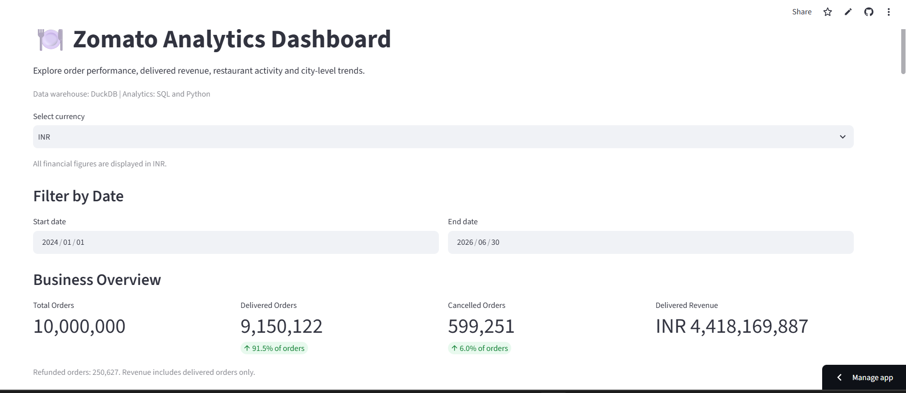
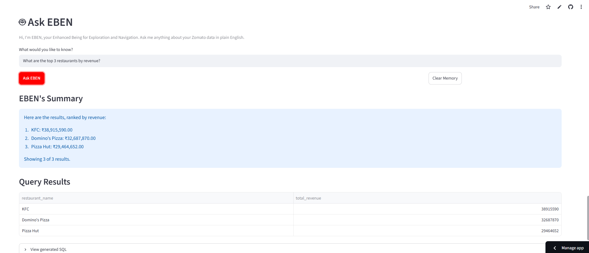

# 🍽️ Zomato AI Data Engineering Platform

An end-to-end data engineering and AI analytics project that transforms **10 million food-delivery orders** into business insights through data modeling, analytics dashboards, and natural-language querying.

🔗 **Live Dashboard:** [Try EBEN](https://zomato-eben-ai.streamlit.app/)  
💻 **GitHub Repository:** [View Source Code](https://github.com/ManLikeEben/zomato-ai-data-engineering)

## 🚀 Project Overview

This project demonstrates how large-scale food-delivery data can be processed, transformed, validated, and analyzed through an end-to-end data engineering workflow.

The platform combines a DuckDB analytical warehouse, dbt transformations, an interactive Streamlit dashboard, and an AI-powered SQL assistant called **EBEN (Enhanced Being for Exploration & Navigation)**.

Users can explore business metrics through the dashboard or ask EBEN questions in plain English to generate and execute SQL queries against the analytics database.

## ✨ Key Features

- **Large-Scale Data Processing:** Processes 10 million food-delivery orders alongside millions of related order items and other datasets.
- **Analytical Data Warehouse:** Uses DuckDB to support efficient analytical queries over large datasets.
- **Data Transformation with dbt:** Implements dimensional models, fact tables, analytical models, and automated data quality tests.
- **AI-Powered SQL Assistant (EBEN):** Converts natural-language questions into SQL queries and returns data-driven answers using Gemini.
- **Interactive Analytics Dashboard:** Built with Streamlit to explore revenue, order trends, restaurant performance, and other business metrics.
- **Cloud Deployment:** Deploys the application through Streamlit Community Cloud, with the analytics database hosted separately on Hugging Face.
- **Data Quality Validation:** Validates dataset relationships and transformations to improve analytical reliability.

## 📈 Technical Achievements

| Metric | Result |
|---|---:|
| Food-delivery orders processed | 10,000,000 |
| Delivered orders | 9,150,122 |
| Delivery success rate | 91.50% |
| Delivered order revenue | ₹4,418,169,887 |
| Data coverage | Jan 2024 – Jun 2026 |

*Metrics reflect the project's current dataset and analytical definitions.*

## 🏗️ System Architecture


*The architecture diagram illustrates the data pipeline, analytical warehouse, transformation layer, AI query workflow, and cloud deployment.*

## 📊 Dashboard Preview

Explore key performance indicators, order trends, revenue insights, and restaurant performance through the interactive dashboard.



## 🤖 EBEN: AI-Powered SQL Assistant

EBEN allows users to ask questions about the Zomato dataset in plain English and receive data-driven answers.



## 🏗️ Architecture

```text
Raw CSV Datasets
       │
       ▼
Python + Pandas
       │
       ▼
DuckDB Data Warehouse
       │
       ▼
dbt Transformations & Tests
       │
       ▼
Analytical Data Models
       │
       ├──────────────► Streamlit Dashboard
       │
       └──────────────► EBEN AI Assistant
                              │
                              ▼
                       Google Gemini
                              │
                              ▼
                      SQL Validation
                              │
                              ▼
                      DuckDB Query Results
```

## 🛠️ Technology Stack

| Technology | Purpose |
|---|---|
| Python | Data processing and application logic |
| Pandas | Data cleaning and manipulation |
| DuckDB | Analytical data warehouse |
| SQL | Data querying and analysis |
| dbt | Data transformation and quality testing |
| Streamlit | Interactive web dashboard |
| Google Gemini | Natural-language SQL generation |
| Hugging Face | Hosting the cloud-accessible database |
| Git & GitHub | Version control and source code management |

## 📊 Dataset & Key Metrics

The project processes millions of records across restaurant, customer, food, order, order-item, and review datasets.

| Metric | Validated Result |
|---|---:|
| Total orders | 10,000,000 |
| Delivered orders | 9,150,122 |
| Delivery success rate | 91.50% |
| Total delivered revenue | ₹4,418,169,887 |

The dataset covers **1 January 2024 to 30 June 2026**.

These figures reflect the project's dataset and analytical definitions, not official live Zomato business statistics.

## 🤖 Meet EBEN: AI-Powered Data Querying

EBEN allows users to ask questions about the warehouse in natural language rather than writing SQL manually.

Example questions:

- How many orders were delivered?
- What is the total revenue from delivered orders?
- What are the top 10 restaurants by revenue?
- Which month had the highest revenue?
- What is the delivery success rate?

### How it works

1. The user submits a question.
2. Google Gemini generates a DuckDB SQL query.
3. The application validates the generated SQL.
4. DuckDB executes the query against the analytical database.
5. EBEN presents the results in a readable format.

## 📈 Analytical Capabilities

The platform supports exploration of:

- Order volumes and delivery performance.
- Delivered revenue and monthly trends.
- Restaurant revenue rankings.
- Customer and food-related analytics.
- Business performance indicators.

## ☁️ Deployment

The dashboard is deployed using Streamlit Community Cloud, while the analytical database is hosted on Hugging Face.

This setup makes the project accessible online without requiring a continuously running personal computer or a paid cloud database.

The Gemini API is used for AI-powered querying. API availability and quota limits may affect response reliability.

## 🔒 Security & Data Integrity

- API credentials are stored outside source code.
- Environment files containing secrets are excluded from version control.
- The AI query workflow validates generated SQL before execution.
- The original local warehouse is retained separately from the cloud-accessible database.
- Data transformations are tested to help ensure consistency and reliability.

## 💻 Local Setup

Follow these steps to run the Zomato AI Data Engineering Platform on your local machine.

### Prerequisites

- Python 3.13
- Git
- A Google Gemini API key for AI-powered querying

### 1. Clone the Repository

```bash
git clone https://github.com/ManLikeEben/zomato-ai-data-engineering.git
cd zomato-ai-data-engineering
```

### 2. Create and Activate a Virtual Environment

On Windows PowerShell:

```powershell
python -m venv .venv
.\.venv\Scripts\Activate.ps1
```

On macOS or Linux:

```bash
python3 -m venv .venv
source .venv/bin/activate
```

### 3. Install Dependencies

```bash
python -m pip install -r requirements.txt
```

### 4. Configure Environment Variables

Create a local `.env` file by copying `.env.example`.

On Windows PowerShell:

```powershell
Copy-Item .env.example .env
```

Open `.env` and replace the placeholder with your own Gemini API key:

```env
AI_PROVIDER=gemini
GEMINI_API_KEY=your_actual_gemini_api_key
```

**Security:** Never commit your `.env` file or share your API key publicly.

### 5. Access the Database

The project uses DuckDB for analytical queries. Follow the database configuration in the project to access the hosted analytics database or use a compatible local database.

The original local warehouse is not required to be uploaded to GitHub.

### 6. Run the Dashboard

```bash
streamlit run streamlit_app/app.py
```

Streamlit will provide a local URL, typically `http://localhost:8501`, where you can access the dashboard.

### 7. Explore EBEN

Once the dashboard is running and your API key is configured, use EBEN to ask natural-language questions about the Zomato dataset and explore the resulting analytics.

## 🔮 Potential Future Improvements

- Add automated pipeline scheduling.
- Expand automated data quality monitoring.
- Improve query-result visualization.
- Add further business KPIs and analytical views.
- Add automated deployment and testing workflows.

## 👨‍💻 Author

**Ebenezer Oluwajuwon Olatunya**

Data Analytics | Data Engineering | AI Applications

[GitHub Profile](https://github.com/ManLikeEben)